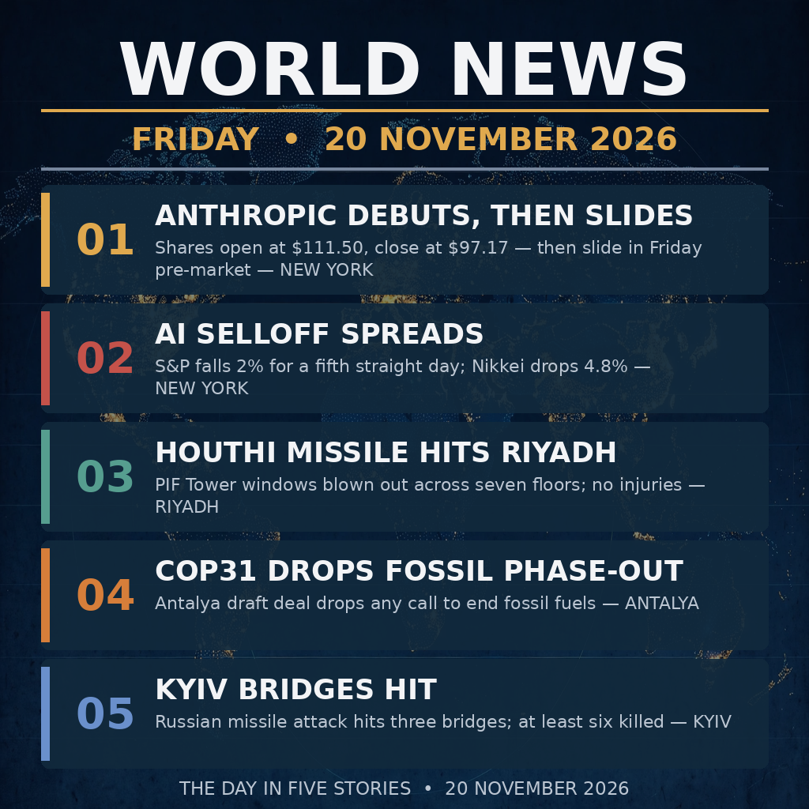

[](https://make.fun/bounty/news-image-20261120)
[](https://make.fun/bounty/news-image-20261120)
[](https://make.fun/bounty/news-image-20261120)

# The day in five stories — 20 November 2026

One image summing up the world's news of Friday 20 November 2026, for the
[make.fun bounty](https://make.fun/bounty/news-image-20261120) of the same name.



A newspaper front page: the masthead names the day, then the five biggest
stories, each with a headline, one factual subline and its dateline.

1. **Anthropic debuts, then slides** — shares open at $111.50, close at
   $97.17, then slide in Friday pre-market (New York)
2. **AI selloff spreads** — S&P falls 2% for a fifth straight day; Nikkei
   drops 4.8% (New York)
3. **Houthi missile hits Riyadh** — PIF Tower windows blown out across seven
   floors; no injuries (Riyadh)
4. **COP31 drops fossil phase-out** — Antalya draft deal drops any call to
   end fossil fuels (Antalya)
5. **Kyiv bridges hit** — Russian missile attack hits three bridges; at least
   six killed (Kyiv)

## How it was built

The background (a dark dotted world map, no text) is AI-generated; every word
on the image is drawn with PIL by `scripts/compose.py`, so the letters stay
crisp at any size. The entry program `main.ts` (Node 22, standard library
only) copies `entry.png` to `/output/entry.png` — no network, deterministic.

```sh
mkdir -p out && MAKEFUN_OUTPUT_DIR=out node main.ts
```

## Sources

OneTurn world brief 20 Nov 2026, WSJ (Houthi strike on Riyadh, Anthropic
close), Reuters (PIF Tower damage), Barron's and NY Post (Anthropic debut),
Morningstar (Asian equities tumble, 20 Nov 01:15 ET).
